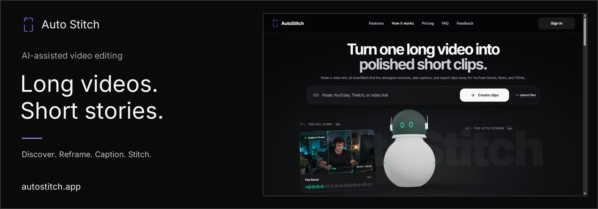
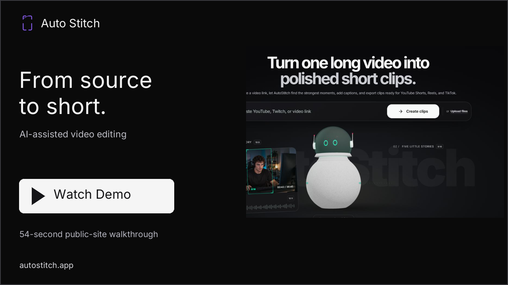

# Auto Stitch

Auto Stitch is a proprietary AI-assisted video-editing application that turns long-form videos into short, vertical clips. It brings clip discovery, framing, captions, and editing into one creator workflow.

**Live Application:** [https://autostitch.app](https://autostitch.app)

## Overview

Start with a supported video link or an uploaded file, then shape selected moments into content for YouTube Shorts, Reels, and TikTok. Auto Stitch helps creators spend less time sorting footage and more time reviewing the edit.

## Product Demo

[Watch or download the MP4](https://github.com/kokoc30/Auto-Stitch/releases/download/showcase-v1/auto-stitch-public-walkthrough.mp4) · 54 seconds · silent public-site walkthrough. The video shows the homepage, input controls, and public feature illustrations. It does not demonstrate an authenticated editing session or a newly generated clip.

## Key Features

Capabilities documented on the live beta website:

- AI-assisted clip discovery and selection.
- Automatic vertical reframing and smart zoom.
- Automated captions with styling.
- Manual video stitching and clip reordering.
- Clip previews and downloads.
- Supported YouTube publishing and scheduling.

## Access

Try the beta at [autostitch.app](https://autostitch.app). Creating clips requires an account.

This repository is a public product showcase. The application source code, AI processing pipelines, infrastructure, and production configuration are privately maintained and are not included.
